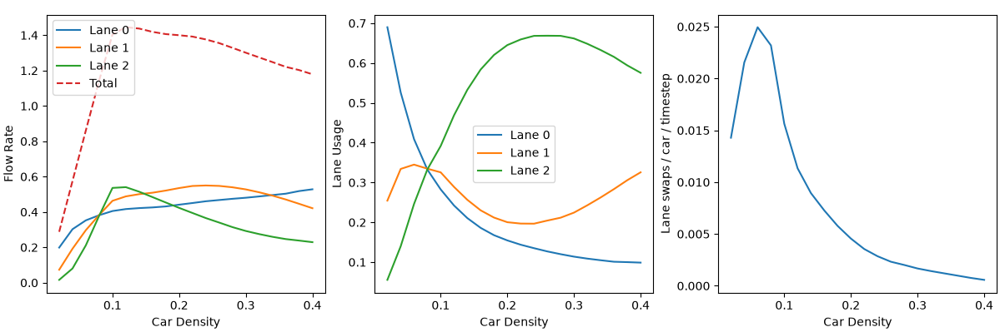

# Traffic Simulation

C++ reimplementation of a traffic simulation from a previous project.

It is a Nagel–Schreckenberg cellular automaton on a circular, multi-lane road.
The road is a grid of cells, and time advances in discrete steps.

All cars update synchronously by:
- accelerating up to `vMax`
- braking to avoid the car ahead
- randomly braking with probability `p`

On multi-lane roads,
cars may change lanes if they meet two criteria:
- *security rule* to ensure there is a gap
- *incentive rule* based on Nagel's velocity suggestion

I follow the UK asymmetrical system,
where a vehicle can only pass on the right.

Lane `0` is the leftmost lane, and higher indices are further right.

## Python bindings

[Nanobind](https://github.com/wjakob/nanobind) exposes the C++ simulation engine to a python interface.
I have used this for quickly plotting the results with Matplotlib.

### `density_sweep.py`

## References

The model and update rules follow:

- K. Nagel and M. Schreckenberg (1992).
    "A cellular automaton model for freeway traffic," *J. Phys. I France* 2.12, pp. 2221–2229.
    DOI: [10.1051/jp1:1992277](https://doi.org/10.1051/jp1:1992277)
- Kai Nagel, Dietrich E. Wolf, Peter Wagner and Patrice Simon (1998).
    "Two-lane traffic rules for cellular automata: A systematic approach" *Phys. Rev. E*, 58.2, pp. 1425–1437.
    DOI: [10.1103/PhysRevE.58.1425](https://doi.org/10.1103/PhysRevE.58.1425)
